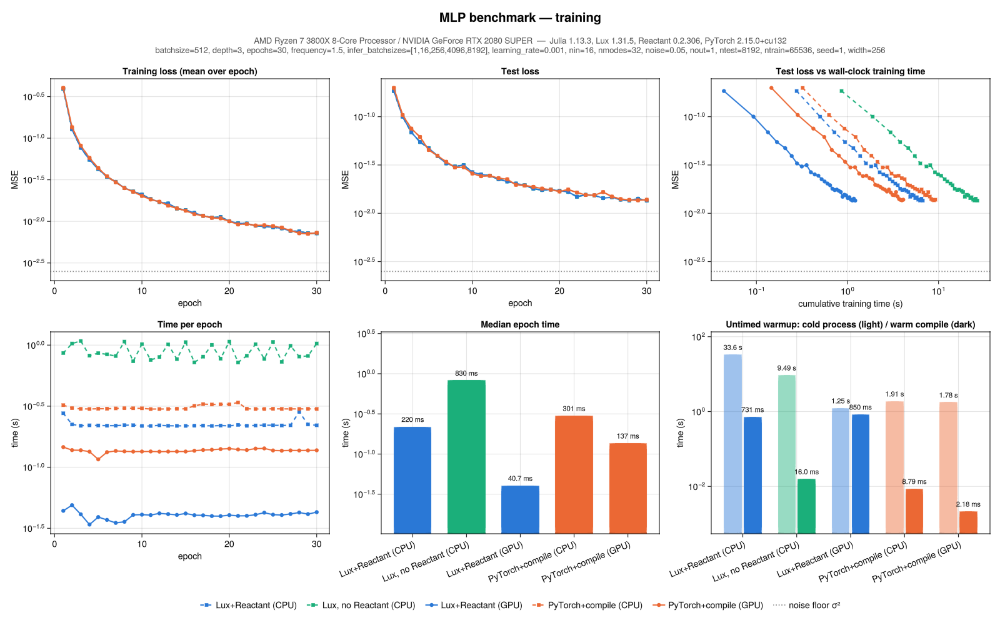
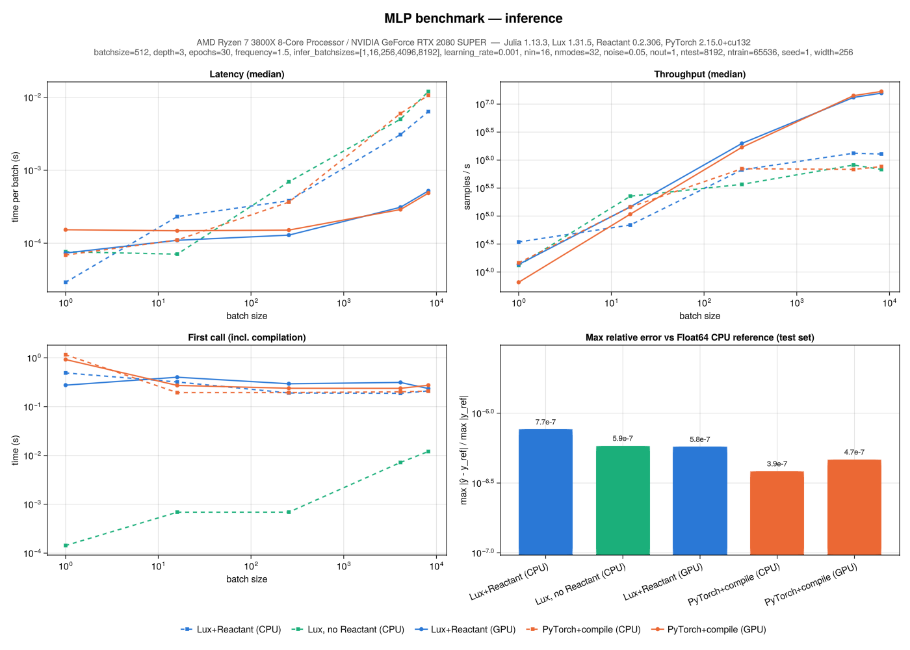
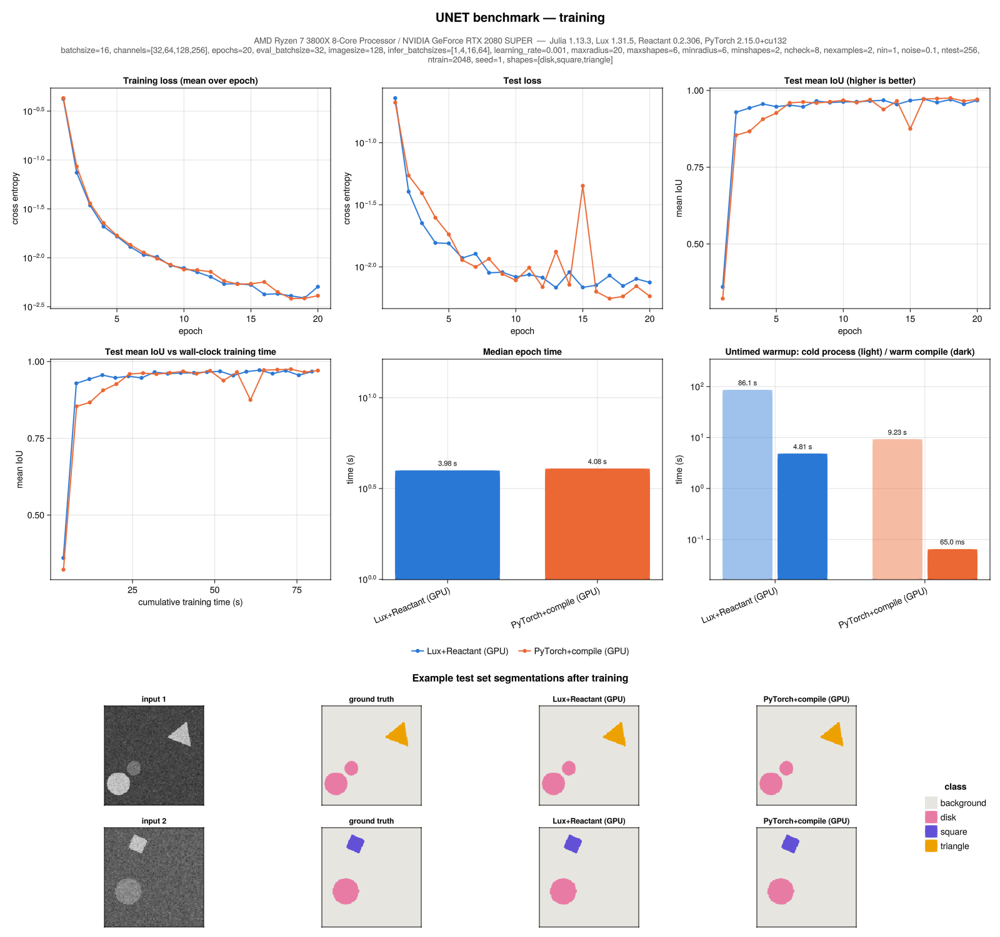
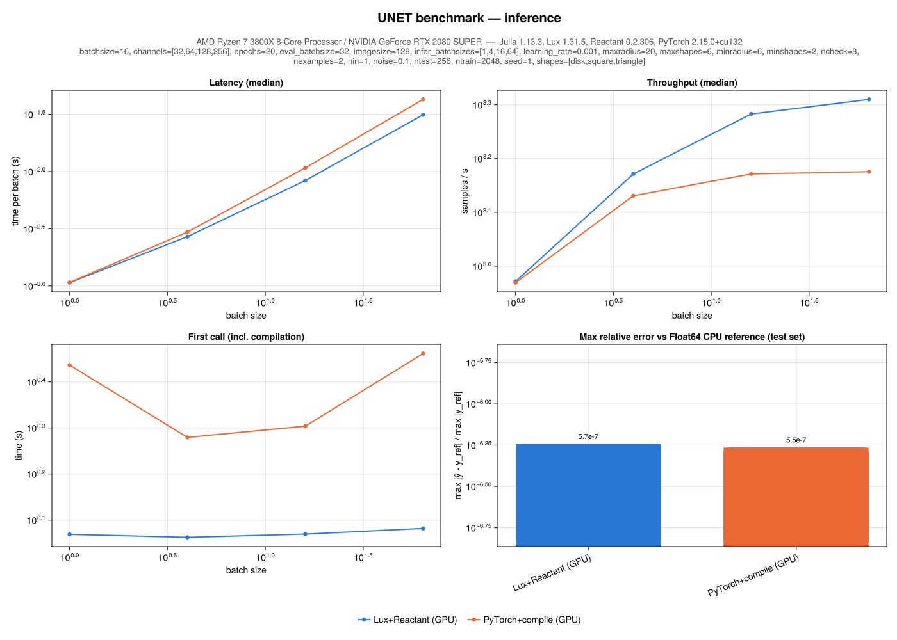

# PracticalLuxBench

Practical training and inference benchmarks comparing [Lux.jl](https://github.com/LuxDL/Lux.jl)
(compiled with [Reactant.jl](https://github.com/EnzymeAD/Reactant.jl)) to
[PyTorch](https://pytorch.org/) (with `torch.compile`).  The aim is to see how close Lux is to being
a viable alternative to PyTorch on realistic, if small, problems: both how fast it is and whether
models train to the same result.

**No elaborate setup or tuning was done for either framework.**  Both are used the way their
documentation and tutorials suggest: Lux with `reactant_device()`, `Training.single_train_step!` and
`@compile`, and PyTorch with `torch.compile(model)` and a standard training loop.  Both use their
default compiler settings and the same plain Adam optimizer.  The results are meant to roughly
represent what a user gets out of the box, not the best performance each framework can achieve.

There are two benchmarks:

- **MLP regression**: a small multi-layer perceptron, mainly a sanity check, run on both CPU and GPU.
- **U-net segmentation**: image segmentation of synthetic shapes, run on the GPU.

## Usage

Requirements: Julia 1.13 or later and [`uv`](https://docs.astral.sh/uv/),
which manages the python environment in `python/` automatically.  A CUDA GPU is needed for the
GPU benchmarks.

```sh
julia --project=. -t auto scripts/mlp.jl          # run and plot the MLP benchmark
julia --project=. -t auto scripts/unet.jl         # run and plot the U-net benchmark
julia --project=. scripts/unet.jl plot            # only re-plot from existing results
```

Each script accepts `run`, `plot` or `all` (the default), `--quick` for a tiny version of the problem,
`--dir DIR` for the results directory (default `results/`) and `--backends` for a comma separated
list of backends:

| backend              | description                                                    |
|----------------------|----------------------------------------------------------------|
| `lux-cpu`, `lux-gpu` | Lux compiled with Reactant, differentiated with Enzyme         |
| `lux-cpu-noreactant` | Lux run natively on the CPU, differentiated with Zygote        |
| `torch-cpu`, `torch-gpu` | PyTorch with `torch.compile`                               |
| `torch-cpu-eager`, `torch-gpu-eager` | PyTorch in eager mode (not run by default, not plotted) |

From Julia:

```julia
using PracticalLuxBench
benchmark(MLPBenchmark(; epochs=10))                  # writes results/mlp_{train,infer}.json
benchmark(UNetBenchmark(); backends=[LuxBackend(:gpu), TorchBackend(:gpu; compile=false)])
plotresults("unet")                                   # writes results/unet_{train,infer}.png
```

## Methodology

- **Identical inputs.**  All synthetic data are generated in Julia from a seed, and the initial
  Lux parameters are copied into the PyTorch models, so every backend starts from the same weights
  on the same data.  Only the order of minibatches within an epoch differs between frameworks.
- **PyTorch runs in its own process.**  Julia launches the python benchmarks with `uv run`.  Data
  are exchanged as raw binary files, and all timing is done inside python after data loading, so no
  Julia↔Python overhead is included.
- **No compilation in timed epochs.**  Before timing, each backend runs a few untimed training
  steps so that compilation (and one-time costs such as Julia JIT compilation and CUDA
  initialization) is excluded from the epoch timings.  Compile times are still recorded and shown in
  the plots, but they are not a focus: for models of practical size they are small compared to
  training time.
- **Training** uses Adam (learning rate 1e-3) with device-resident data and fixed batch shapes.
  Each epoch's time ends with a synchronization.  The test set is evaluated after every epoch to
  confirm convergence; this is not included in the epoch time.
- **Inference** is timed for several batch sizes after compilation, as the median of repeated
  synchronized calls.  The first call per batch size (including compilation) is reported separately.
- **Numerical agreement.**  Inference predictions from the initial weights are compared to a
  Float64 CPU reference computed with plain Lux.
- **Minimal settings.**  Both frameworks use FP32 (the RTX 2080 SUPER has no TF32 anyway).  The
  only non-default settings are common one-liners or are needed by the benchmark harness:
  - `torch.compile` uses static shapes, like Reactant.
  - `cudnn.benchmark` is enabled for the U-net, since XLA autotunes convolutions by default.
  - Inductor's on-disk caches are disabled so that results do not depend on previous runs.
  - Reactant's default preallocation of 75% of GPU memory is disabled so that the PyTorch
    subprocess has room to run.  For the U-net, Reactant's GPU memory cap is also lowered to 50%
    (set in `scripts/unet.jl` unless `XLA_REACTANT_GPU_MEM_FRACTION` is set), since XLA's allocator
    does not return memory and could otherwise grow to leave too little for PyTorch.

## Results

Results below are from an AMD Ryzen 7 3800X with an NVIDIA GeForce RTX 2080 SUPER (8 GB), using
Julia 1.13.3, Lux 1.31.5, Reactant 0.2.306 and PyTorch 2.15.0 (CUDA 13.2).  The raw results are in
`results/*.json`.  The exact versions of all dependencies used are pinned in `Manifest.toml` for Julia
and in `python/pyproject.toml` and `python/uv.lock` for python, so the results should be
reproducible by running the benchmarks from this repository as is.  Results with other versions may
differ, since both frameworks are under active development.

### MLP regression

A 3 hidden layer MLP (width 256, GELU) fit to a random sum of sinusoids in 16 dimensions with
Gaussian noise; 65,536 training samples, batch size 512, 30 epochs.

| backend                | median epoch | final test MSE |
|------------------------|-------------:|---------------:|
| Lux+Reactant (GPU)     |      41 ms   |        0.0135  |
| PyTorch+compile (GPU)  |     137 ms   |        0.0138  |
| Lux+Reactant (CPU)     |     220 ms   |        0.0135  |
| PyTorch+compile (CPU)  |     301 ms   |        0.0138  |
| Lux, no Reactant (CPU) |     830 ms   |        0.0135  |

- All five backends follow essentially the same loss curves.  The Lux backends agree with each other
  exactly, and PyTorch differs only through the order of minibatches.
- Lux+Reactant is the fastest to train on both GPU and CPU: over 3× faster than PyTorch on the GPU
  and about 25% faster on the CPU.  Lux without Reactant is about 4× slower than with it on the CPU.
- For inference on the GPU, Lux has lower latency at small and medium batch sizes (0.07 vs 0.15 ms at
  batch size 1) and PyTorch is slightly faster at the largest (0.49 vs 0.52 ms at 8192).  On the CPU,
  Lux+Reactant is fastest at large batch sizes (6.4 vs 10.7 ms at 8192).
- All predictions agree with the Float64 reference to within 8e-7 relative error.
- The test MSE has not yet reached the noise floor (σ² = 0.0025) after 30 epochs; this does not
  affect the comparison.




### U-net segmentation (GPU)

Single-channel 128×128 images with 2–6 randomly placed, sized and rotated disks, squares and
triangles on a noisy gradient background.  Shape brightness is independent of shape kind, so the
network must segment by geometry.  The U-net has four levels (32, 64, 128 and 256 channels), batch
normalization, max pooling and transposed convolutions.  Training uses 2048 images with batch size
16 for 20 epochs.

| backend               | median epoch | final test mIoU | pixel accuracy |
|-----------------------|-------------:|----------------:|---------------:|
| Lux+Reactant (GPU)    |      3.98 s  |          0.967  |         99.8%  |
| PyTorch+compile (GPU) |      4.08 s  |          0.971  |         99.8%  |

| batch size | Lux+Reactant inference | PyTorch+compile inference |
|-----------:|-----------------------:|--------------------------:|
|          1 |                 1.07 ms |                   1.07 ms |
|          4 |                 2.70 ms |                   2.96 ms |
|         16 |                 8.34 ms |                  10.78 ms |
|         64 |                31.4 ms  |                  42.7 ms  |

- Both frameworks converge to the same quality.  The loss and mean IoU curves track each other
  closely, and both segment the example test images essentially perfectly.  The test mIoU fluctuates
  by about 0.01 from epoch to epoch for both, so the difference in final mIoU is not significant.
- Training speed is about the same, with Lux about 2% faster per epoch.  Lux is faster for
  inference, by about 25% at batch size 64.
- Predictions agree with the Float64 reference to within 6e-7 relative error.
- Startup takes longer with Lux (about 1.5 minutes before training starts in a fresh process,
  mostly one-time Julia compilation, compared to about 10 s for PyTorch).  This is a fixed cost that
  matters little for training runs of practical length.




## Caveats

- The results come from a single run on one machine.  The MLP CPU timings in particular may be
  affected by other load on the machine.
- Lux benchmarks rely on a few Reactant/Lux internals: reusing the compiled training step stored in
  `TrainState.cache`, the `Reactant.XLA.XLA_REACTANT_GPU_PREALLOCATE` setting (set in the
  package `__init__` unless the `XLA_REACTANT_GPU_PREALLOCATE` environment variable is set), and
  the `Reactant.XLA.XLA_REACTANT_GPU_MEM_FRACTION` setting (see above).  These may change between
  versions.
- By design, neither framework is tuned.  For example, `torch.compile(mode="max-autotune")`,
  CUDA graphs, mixed precision and Reactant compile options are not explored, so either framework
  may do better with more effort.

## Layout

- `src/`: the Julia package.  `benchmark.jl` is the generic driver, `lux.jl` the Lux
  training/inference loops, `mlp.jl` and `unet.jl` the benchmarks and their synthetic data, and
  `plots.jl` the figures (made only from the JSON results).
- `python/`: the `uv` project with the PyTorch side.  `mlp.py` and `unet.py` are the benchmarks,
  and `plb/` holds the shared loops, utilities and array exchange with Julia.
- `scripts/`: command line entry points.
- `results/`: JSON results and PNG figures.
